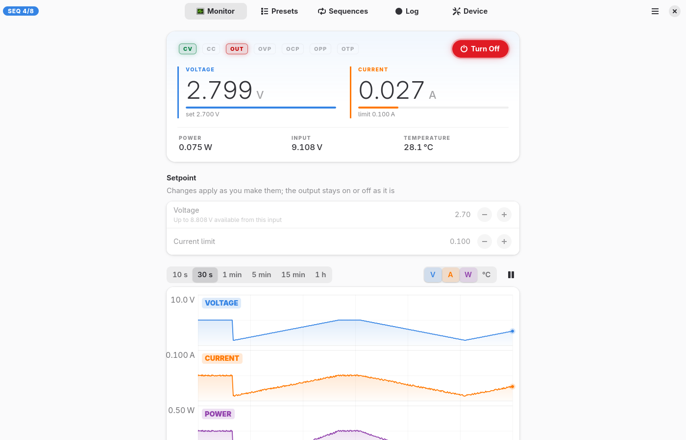
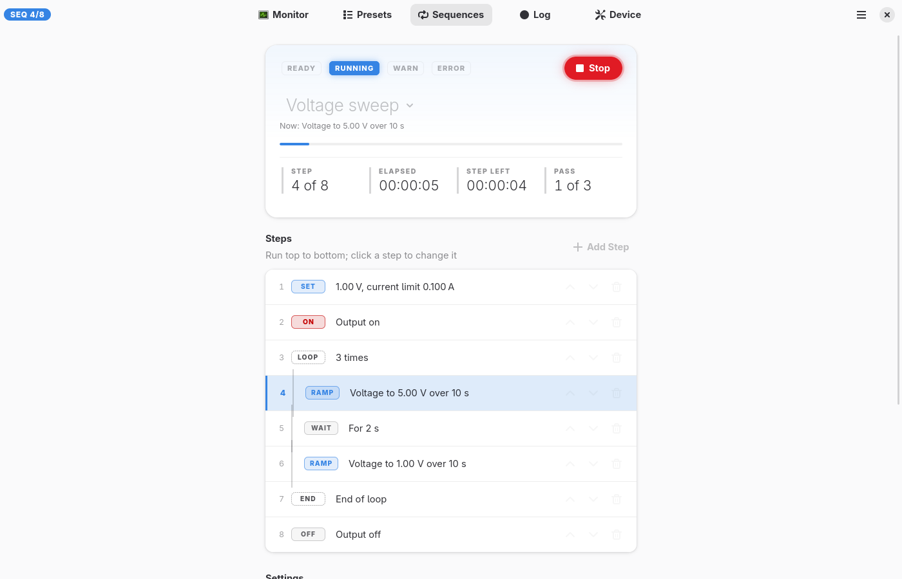
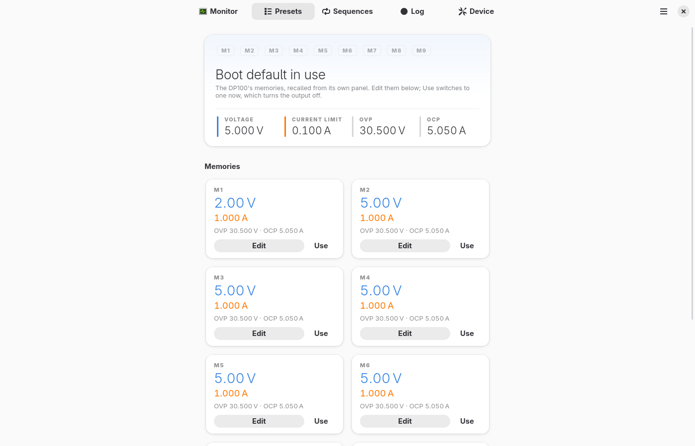

# DP100 Studio

A native Linux app for the ALIENTEK DP100 USB-C bench power supply, built with
GTK 4 and libadwaita.



The DP100 is also sold as the ATK-DP100, and listings translated from Chinese
call it the "Point Atom DP100 CNC power supply" (正点原子 DP100 数控电源). They
are all the same unit.

## Features

- **Monitor**: live voltage, current and power, with lamps for CV, CC, the
  output and every protection trip, and a graph of up to an hour at 100
  samples a second that keeps every spike visible at any zoom.
- **Control**: setpoints that apply as you change them, an output switch that
  asks before turning on (F9 turns it off from anywhere), and protection
  limits.
- **Presets**: edit and recall the supply's nine memories.
- **Sequences**: steps such as ramps, waits, and waiting for a measurement to
  meet a condition, checked against the supply's limits before they run.
- **Log**: record every measurement to CSV, with energy and charge delivered.
- **Device**: panel, safety and protection settings, and a button to hand the
  front panel back to the DP100.
- A `dp100` command-line tool and a Rust library for the protocol.

<p>
  
  
</p>

## Install

On Arch Linux, from the AUR:

```sh
yay -S dp100-studio        # the latest release
yay -S dp100-studio-git    # or the development version
```

The package installs a udev rule that lets you open the DP100 without root.
Unplug and replug it after installing, then put it in **USBD mode** by
double-tapping ◀ on its panel, which it needs after every power-up.

### From source

Needs Rust 1.88 or newer, GTK 4.14 and libadwaita 1.5 or newer.

```sh
cargo run --release -p dp100-studio
cargo run -p dp100-studio -- --simulate   # a simulated DP100, no hardware needed
```

<a id="device-access"></a>
Without the package, install the udev rule yourself so a normal user can open
the device:

```sh
sudo install -m 644 data/udev/70-dp100.rules /etc/udev/rules.d/
sudo udevadm control --reload
```

Then unplug and replug the DP100.

## Using it

The app connects read-only: opening it never changes anything on the supply.
Only one program can talk to the DP100 at a time, so the app waits while
another has it and connects as soon as it is free.

While the app is connected, the DP100's own buttons are locked; the firmware
does this whenever a computer is polling it. **Release Panel** on the Device
page hands the panel back, and **Reconnect** takes it again.

The DP100 can only output a little less than its input. On a 9 V USB-C
charger that's about 8.8 V. A 20 V PD charger gives about 19.7 V, and the full
30 V needs a DC adapter of up to 32 V on the barrel jack.

## Sequences

A sequence is a list of steps: set the voltage and current, turn the output
on or off, wait, ramp a setpoint, wait until a measurement meets a condition
(say, current below 50 mA for 30 s), and repeat blocks. They're edited on the
Sequences page and stored as TOML; see
[examples/sequences](examples/sequences) for the format.

Before a run, every step is checked against the DP100's protection trips,
its range, and the sequence's own limits. A step above any of them is an
error, not something quietly clamped. A run stops at once on Stop, F9, a
protection trip, lost input power, an unplug, or the output being changed
from elsewhere, and then turns the output off unless the sequence says to
leave it.

## CLI

```sh
dp100 status
```

```
input    9.10 V (max output 8.81 V)
output   off  0.000 V  0.000 A  0.000 W  [off]
preset   0  set 2.49 V 0.500 A  ovp 30.50 V  ocp 5.050 A
temp     28.1 / 27.6 °C   5V rail 5.07 V   fault ok
```

`dp100 --help` lists the rest: `watch` streams measurements at up to 100 Hz,
`set` changes setpoints, and `on` asks before it enables the output.

## Safety

The software never changes device state on its own. Opening, reading and
watching send only read requests; setpoint changes leave the output as it was;
nothing turns the output on except an explicit request. Every write is checked
by reading it back. Even so, this is unofficial software driving a power
supply. Check what's connected before you turn the output on.

## The code

| Crate | What | License |
|---|---|---|
| [`dp100`](crates/dp100) | Protocol library and `dp100` command-line tool | MIT OR Apache-2.0 |
| [`dp100-studio`](crates/dp100-studio) | The desktop app | GPL-3.0-or-later |

The protocol, and the firmware quirks the library works around, are
documented in [docs/PROTOCOL.md](docs/PROTOCOL.md). See
[CONTRIBUTING.md](CONTRIBUTING.md) for running the checks, the hardware tests
and the simulator.

## Credits

The protocol was pieced together by others first; see
[docs/PROTOCOL.md](docs/PROTOCOL.md#credits).

Not affiliated with or endorsed by ALIENTEK. DP100 and ALIENTEK are trademarks
of their respective owners.
